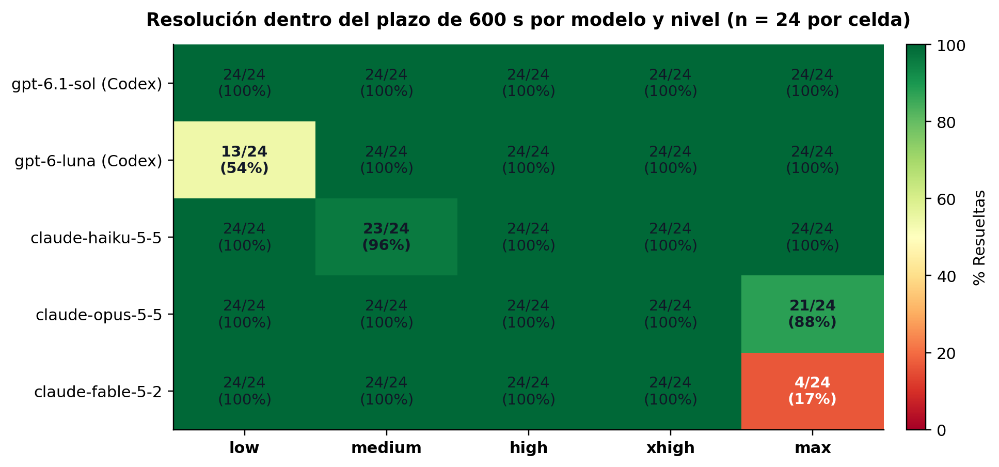
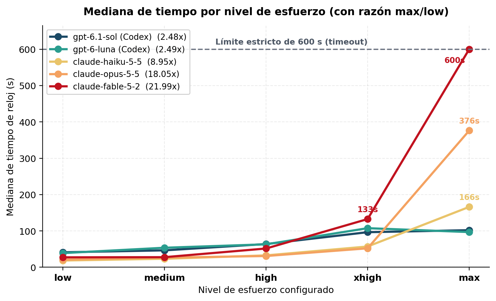
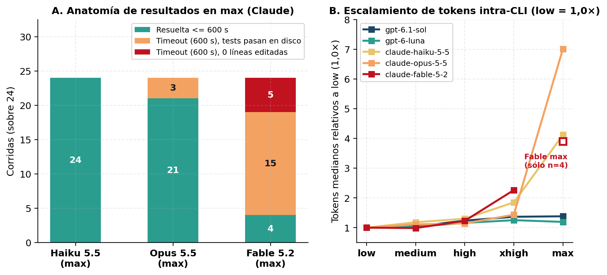

# Subir el razonamiento al máximo no hace que la IA programe mejor (y a veces la rompe)

Si usás herramientas como Claude Code o Codex, seguro ya escuchaste la regla de oro que circula entre desarrolladores: *«No lo dejes siempre en razonamiento máximo: tarda el triple, te quema la cuota y sobre-piensa cosas simples. Bajalo a Medium y resolvés casi todo más rápido»*.

No es sólo charla de redes. El propio creador de Claude Code, [Boris Cherny][hn], contó en Hacker News que pasaron el valor por defecto a `medium` buscando el equilibrio entre inteligencia, velocidad y costo. Y la [documentación oficial de Anthropic][docs-ant] advierte explícitamente que subir el esfuerzo al máximo en tareas estructuradas o simples puede provocar *overthinking*. Por su parte, mediciones independientes de Artificial Analysis citadas por [Pascal Reischl][reischl] mostraron que Opus 5.5 consume **4,5 veces** más recursos en `max` que en `medium` (**11 veces** frente a `low`).

En CrisoLabs nos hicimos una pregunta concreta: **¿qué pasa de verdad cuando agarramos las mismas tareas de programación, el mismo banco de tests ocultos y sólo movemos esa perilla de `low` a `max` en cinco modelos distintos?**

No hicimos una encuesta ni probamos dos prompts sueltos: **ejecutamos 600 corridas controladas** (y algunas pruebas extra de control y diagnóstico).

## Qué probamos y cómo

Armamos un banco fijo de **8 tareas reales en Python** (`34` archivos verificados por hash criptográfico antes de arrancar para no cambiar nada en el camino):
- **5 cambios chicos** (de unas 10 líneas): partir lotes manteniendo generadores, unir intervalos cerrados, parsear importes estrictos con coma, calcular *backoff* exponencial determinista y actualizar parámetros de una URL.
- **3 módulos completos de diseño** (entre 68 y 85 líneas de referencia): un libro de inventario atómico, un planificador de tareas por grafo de dependencias y capacidad, y una caché LRU con expiración por tiempo.

En cada corrida, el agente recibía una carpeta limpia con el problema y tenía **10 minutos de reloj (600 segundos)** para resolverlo, sin ver los tests ocultos que usábamos después para calificarlo. Probamos los **5 niveles** (`low`, `medium`, `high`, `xhigh`, `max`) con **3 repeticiones** por tarea en **5 modelos**:
- `gpt-6.1-sol` y `gpt-6-luna` (vía Codex CLI)
- `claude-haiku-5-5`, `claude-opus-5-5` y `claude-fable-5-2` (vía Claude Code)

> Nota transparente de método: `claude-fable-5-2` agotó la cuota de suscripción tras las primeras `27` corridas evaluables, así que completamos las `93` restantes mediante API key oficial bajo una enmienda pre-registrada, sin tocar los resultados anteriores.

## Qué pasó en las 600 corridas

Lo primero que salta a la vista es que **no existe una regla única para todos los modelos**:

| Modelo | Resueltas / 120 | Lo que pasó de verdad | Tiempo `low → max` |
|---|---:|---|---:|
| **`gpt-6.1-sol`** | **120 / 120** | Resolvió `24/24` en todos los niveles | **2,48×** (`41 s → 102 s`) |
| **`gpt-6-luna`** | **109 / 120** | Falló casi la mitad en `low` (**13/24**), saltó a **24/24** desde `medium` | **2,49×** (`39 s → 97 s`) |
| **`claude-haiku-5-5`** | **119 / 120** | Un tropiezo suelto en `medium` (`23/24`); `max` no sumó nada | **8,95×** (`19 s → 166 s`) |
| **`claude-opus-5-5`** | **117 / 120** | `24/24` hasta `xhigh`; **3 timeouts** de 600 s en `max` (**21/24**) | **18,05×** (`21 s → 376 s`) |
| **`claude-fable-5-2`** | **100 / 120** | `24/24` hasta `xhigh`; **colapsó a 4/24 en `max` (20 timeouts)** | **21,99×** (`27 s → 600 s`) |

## Los tres descubrimientos que rompen el sentido común

### 1. En `max`, Fable 5.2 no «tardó el triple»: tardó 22 veces más y venció el reloj
La famosa regla del «triple de tiempo» quedó corta en dos direcciones: en Codex (`sol` y `luna`), `max` tardó **2,5×** más que `low`; en cambio, en Claude Code explotó a **8,95×** en Haiku, **18,05×** en Opus y **21,99×** en Fable 5.2.

Y lo más llamativo ocurrió al mirar qué había dejado escrito **Fable 5.2** en esas **20 corridas de `max` que murieron a los 10 minutos**:
- En **15 de las 20**, el código guardado en el disco **ya pasaba el 100 % de los tests ocultos**. El modelo ya había encontrado la solución, pero siguió verificando o dando vueltas hasta que lo mató el cronómetro. (Lo mismo pasó en los 3 timeouts de Opus `max`).
- En las otras **5 corridas**, quemó los 10 minutos enteros con **cero líneas cambiadas**: no llegó ni a editar el archivo.

### 2. Bajar a `low` tampoco es gratis en todos los modelos: el caso de Luna
Si mirás la tabla, `gpt-6-luna` resolvió **13/24 en `low`** y **24/24 en `medium`**. ¿Era porque no le daba la lógica en `low`? Hicimos 6 pruebas diagnósticas aparte para verlo por dentro: en **4 de los 6 fallos**, cuando un comando de lectura en terminal falló con código `127`, el agente en `low` **bajó los brazos con cero líneas editadas** y pidió ayuda; en los **2 casos que sí resolvió**, también chocó contra el error `127`, pero buscó otro camino (`rg` o comandos internos de Bash). En `medium`, ese problema desapareció.

### 3. Ningún modelo tocó archivos ajenos (la trampa del `__pycache__`)
Nuestro arnés automático marcó alertas de «archivos fuera de alcance» en Haiku (`32` veces) y Opus (`40` veces). Antes de acusarlos de desobedientes, revisamos qué archivos habían creado: **el 100 % eran archivos `.pyc` dentro de `__pycache__`** por correr `python3` durante sus propias pruebas. En las 600 corridas de los 5 modelos hubo **cero** modificaciones a archivos fuente no autorizados.

## Qué te llevás para tu flujo diario (y qué NO demuestra este estudio)

- **Sí muestra:** Poner el esfuerzo en `max` «por las dudas» en tareas acotadas y bien especificadas es contraproducente. En nuestros datos, `medium` resolvió el 100 % en cuatro de cinco modelos (y 119/120 en Haiku), mientras que `max` disparó la latencia entre `9×` y `22×` y provocó colapsos de tiempo en Opus (`3/24`) y Fable 5.2 (`20/24`).
- **No demuestra:** Estas tareas son ejercicios chicos de Python (`8`–`85` líneas), no repositorios grandes de producción; los tests miden corrección funcional, no elegancia del código; y los tokens entre Codex y Claude se contabilizan distinto y no equivalen directo a dinero.

Si querés verificar los números fila por fila, bajar el banco de tareas o leer el informe técnico completo en [español][paper-es] o [inglés][paper-en], tenés todo reproducible en el repositorio del experimento.

[hn]: https://news.ycombinator.com/item?id=47664442
[docs-ant]: https://platform.claude.com/docs/en/build-with-claude/effort
[reischl]: https://pascalreischl.com/en/blog/claude-effort-levels/
[paper-es]: ../experimentos/03-esfuerzo-de-razonamiento/paper/paper-es.md
[paper-en]: ../experimentos/03-esfuerzo-de-razonamiento/paper/paper-en.md
