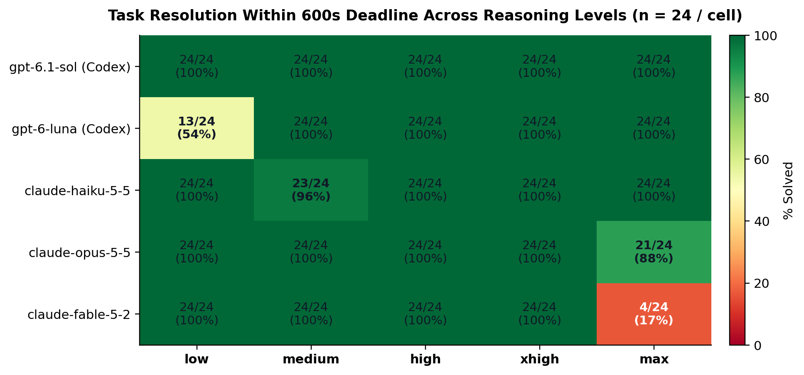
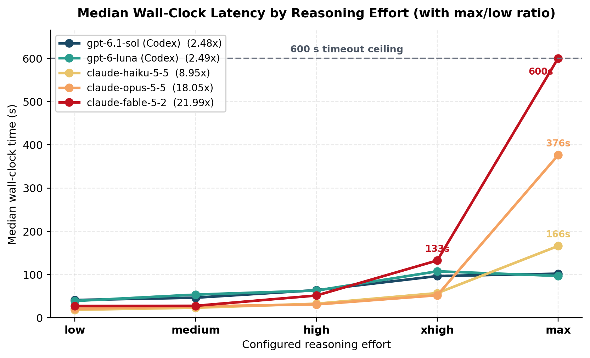
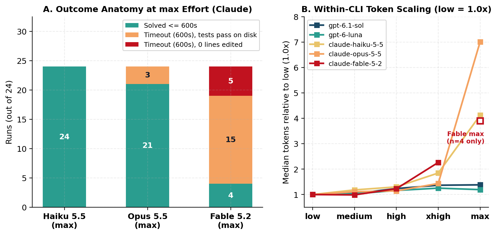

# Does Higher Reasoning Effort Make Coding Agents Perform Better? A Pre-Registered Empirical Study of Five Models Across 600 Agentic Runs

**Luis Arancibia · CrisoLabs**  
*Technical Report · Experiment 03 · November 15, 2026*  
*Companion artifacts and reproduction harness: `experimentos/03-esfuerzo-de-razonamiento/`*

---

## Abstract

Practitioner heuristics and provider defaults frequently claim that setting coding agents to `medium` reasoning effort captures roughly 90% of quality while avoiding a "3x latency penalty" and "overthinking" from `high` or `max` effort. We put this claim to a pre-registered empirical test across **600 primary evaluable runs** (5 models × 5 effort levels × 8 Python coding tasks × 3 repetitions), plus 8 `high` cross-batch controls, 6 diagnostic runs, and 3 excluded protocol-baseline runs. The models evaluated are `gpt-6.1-sol` and `gpt-6-luna` via Codex CLI (`0.166.0`), and `claude-haiku-5-5`, `claude-opus-5-5`, and `claude-fable-5-2` via Claude Code (`2.1.317`), under a strict 600-second wall-clock deadline and a frozen SHA-256 hidden test suite.

**Results refute any universal rule.** Neither a fixed "3x slowdown" nor monotonic improvement with higher effort holds across models:
1. **`gpt-6.1-sol`** hit a 100% ceiling across all levels (`24/24` at `low` through `max`), scaling wall-clock median latency by **2.48×** (`41.1 s` to `102.0 s`) and tokens by **1.38×**.
2. **`gpt-6-luna`** genuinely needed to leave `low`: accuracy jumped from **`13/24` (54%) at `low`** to **`24/24` (100%) at `medium`–`max`** (`+11` solved runs), with no additional accuracy gains above `medium`. A separate 6-run diagnostic at `low` revealed tool-interaction fragility (`4/6` abandoned with `0` lines edited after shell read commands returned exit code `127`, whereas `2/6` worked around the failure using `rg` or shell builtins).
3. **`claude-haiku-5-5`** resolved `119/120` runs (`23/24` at `medium`, `24/24` elsewhere) while scaling latency **8.95×** (`18.6 s` to `166.1 s`) and tokens **4.12×**.
4. **`claude-opus-5-5`** resolved `24/24` from `low` to `xhigh` (`20.8 s` to `52.1 s`), then dropped to **`21/24` at `max`** due to **3 timeouts at 600 s** (latency ratio **18.05×**, partial token ratio **7.01×** over `n = 21` receipts).
5. **`claude-fable-5-2`** (completed across `27` OAuth + `93` API-key runs after hitting subscription quota) achieved **`24/24` from `low` through `xhigh`**, then collapsed to **`4/24` (17%) at `max`** because **20 of 24 runs exhausted the 600-second wall-clock ceiling** (latency ratio **21.99×**). Crucially, in **15 of those 20 timeouts**, code already saved on disk passed all hidden tests, whereas in the other **5 timeouts**, Fable spent 600 seconds without editing a single line (`0` lines touched).

Finally, automated scope checks caught `0` unauthorized source-file modifications across all 600 runs; every `out-of-scope` flag in Haiku (`32`) and Opus (`40`) was a `__pycache__/*.pyc` bytecode artifact left by running Python during self-verification.

---

## 1. Introduction and Motivation

Modern agentic coding interfaces expose an explicit reasoning-effort knob (`low`, `medium`, `high`, `xhigh`, `max`). Anthropic's platform documentation states that `max` imposes "no constraints on token spending" and warns that higher effort on structured or less intelligence-sensitive tasks "can lead to overthinking" (`anthropic2026effort`). In March 2026, Claude Code creator Boris Cherny explained switching the default to `medium` (`effort=85`) as a "sweet spot on the intelligence-latency/cost curve for most users" (`cherny2026hn`). Similarly, OpenAI recommends reserving `xhigh` for long asynchronous workflows only when evaluations justify the added latency and cost (`openai2026reasoning`). Independent practitioner comparisons using Artificial Analysis benchmarks further noted a **4.5×** usage jump from `medium` to `max` (and **11×** from `low` to `max`) on Opus 5.5, alongside mixed `max` outcomes reported by CodeRabbit (`reischl2026effort`), echoing earlier academic findings on chain-of-thought overthinking in mathematics (`chen2024overthinking`).

Yet informal developer rules of thumb—such as "maximum reasoning takes 3x longer while `medium` handles 90% of code faster and cleaner"—rarely rest on controlled, pre-registered benchmarks across multiple agent models. We designed **Experiment 03** to measure, under identical isolated tasks and pre-registered success criteria, what actually changes across all five effort levels in real CLI coding agents.

---

## 2. Experimental Design and Pre-Registration

### 2.1 Frozen Task Bank

Before any model was invoked, we froze an 8-task Python `3.12.3` standard-library benchmark (`banco-congelado.json`, 34 SHA-256 hashes, commit `3bf43bd`):
- **5 Bounded Tasks** (reference diffs ~3–16 lines): `01-lotes` (batching iterables), `02-intervalos` (merging closed intervals), `03-importes` (strict decimal currency parsing), `04-espera` (deterministic capped exponential backoff), and `05-consulta` (URL query parameter manipulation).
- **3 Design Tasks** (reference modules ~68–85 lines with interacting invariants): `06-inventario` (atomic idempotent inventory ledger), `07-planificador` (DAG dependency scheduler with capacity and failure propagation), and `08-cache` (LRU cache with TTL, injected clock, and thundering-safe lazy loader).

Each run received a fresh temporary directory containing only `inicio/` and `TAREA.md`. Hidden test suites (`ocultos/`) were withheld during agent execution and copied only afterward for isolated grading (30 s test timeout). Every task's starter code was verified to fail hidden tests and every reference solution verified to pass prior to the first pilot.

### 2.2 Pre-Registration, Extensions, and Amendments

To prevent post-hoc metric selection, each expansion was committed prior to execution:
1. **Baseline (`README.md`, commit `e22569c`):** `gpt-6.1-sol` at `low`, `medium`, `high` (72 runs; seed `20261113`).
2. **Extension 01 (`EXTENSION-01.md`, commit `b267ab7`):** added `xhigh` and `max` on `gpt-6.1-sol` (48 main runs + 8 interleaved `high` batch controls; seed `2026111301`).
3. **Extension 02 (`EXTENSION-02.md`, `ENMIENDA-02-01.md`, `ENMIENDA-02-02.md`):** expanded the 5-level matrix (seed `2026111303`) to `gpt-6-luna` (Codex OAuth) and Claude Code `2.1.317` (`claude-haiku-5-5`, `claude-opus-5-5`, `claude-fable-5-2`) using bubblewrap (`bwrap`) isolation and tools `{Read, Edit, Write, Glob, Grep, Bash}`. During `02-02`, `gpt-6-luna` was resumed after fixing a reconnect classification rule (`ENMIENDA-02-01`), and a separate 6-run diagnostic was added for Luna `low`. Meanwhile, `claude-fable-5-2` halted on subscription quota after 28 observed runs (`27` evaluable + `1` quota cutoff `principal-07-planificador-xhigh-2` without functional evaluation + `92` unstarted).
4. **Amendment 02-03 (`ENMIENDA-02-03.md`, commit `0a7ee11`):** completed all **93** unevaluated Fable 5.2 cells (preserving `protocolo-02-02` files byte-for-byte via SHA-256 verification) using `ANTHROPIC_API_KEY` injected in memory inside `bwrap`.

Across all runs: concurrency never exceeded **2 simultaneous agents** (verified via monotonic timestamps), agent wall-clock timeout was fixed at **600 s**, and a run counted as **solved** *only* if the agent process exited cleanly within 600 s and passed 100% of hidden tests within 30 s.

---

## 3. Results Across 600 Evaluable Runs

### 3.1 Summary Matrix by Model and Effort Level

Table 1 reports all **600 primary evaluable runs** (`120` per model, `24` per `model × level` cell).

| Model | Effort | Solved / Eval | Median Time (s) | Time `max/low` | Median Tokens (`n`) | Tokens `max/low` |
|---|---|---:|---:|---:|---:|---:|
| `gpt-6.1-sol` | `low` → `max` | `24/24` at every level (**120/120**) | `41.1` → `46.5` → `63.9` → `96.5` → `102.0` | **2.48×** | `95,549` (`24`) → `132,110` (`24`) | **1.38×** |
| `gpt-6-luna` | `low` / `med`–`max` | **`13/24`** (`low`) / `24/24` (`med`–`max`) (**109/120**) | `38.9` → `53.6` → `63.1` → `107.5` → `96.8` | **2.49×** | `124,519` (`24`) → `148,684` (`24`) | **1.19×** |
| `claude-haiku-5-5` | `low`–`max` | `24/24` (`23/24` at `med`) (**119/120**) | `18.6` → `23.3` → `32.6` → `57.1` → `166.1` | **8.95×** | `47,353` (`24`) → `195,130` (`24`) | **4.12×** |
| `claude-opus-5-5` | `low`–`xhigh` / `max` | `24/24` (`low`–`xhigh`) / **`21/24`** (`max`) (**117/120**) | `20.8` → `26.5` → `30.9` → `52.1` → `376.2` | **18.05×** | `37,179` (`24`) → `260,660` (`21`) | **7.01×** *(partial)* |
| `claude-fable-5-2` | `low`–`xhigh` / `max` | `24/24` (`low`–`xhigh`) / **`4/24`** (`max`) (**100/120**) | `27.3` → `27.7` → `51.6` → `132.6` → `600.2` | **21.99×** | `32,001` (`24`) → `124,818` (`4`) | **3.90×** *(partial, n=4)* |

### 3.2 Latency Scaling vs. the "3x" Rule of Thumb

Figure 2 shows median wall-clock latency across all five levels. Neither model family follows a single multiplier:
- Both Codex models (`gpt-6.1-sol` and `gpt-6-luna`) stayed close to **2.5×** from `low` to `max` (`2.48×` and `2.49×`), and `luna` was actually slightly faster at `max` (`96.8 s`) than at `xhigh` (`107.5 s`).
- All three Claude models exhibited super-linear latency growth at `max`, jumping well beyond 3×: **8.95×** (`claude-haiku-5-5`), **18.05×** (`claude-opus-5-5`), and **21.99×** (`claude-fable-5-2`, censored at the 600 s timeout ceiling). From `medium` to `max`, latency jumped **7.12×** for Haiku, **14.21×** for Opus, and **21.67×** for Fable.

### 3.3 Why Models Failed: Low-Effort Fragility vs. Max-Effort Timeouts

Across all 600 runs, there were **35 functional failures** (`11` in Luna `low`, `1` in Haiku `medium`, `3` in Opus `max`, `20` in Fable `max`), with **0 infrastructure failures** in the evaluable denominator:

1. **Under-effort and Tool Fragility (`gpt-6-luna` at `low`):** Luna failed `11/24` runs at `low` (concentrated in `04-espera` `0/3`, `01-lotes` `1/3`, `03-importes` `1/3`, `08-cache` `1/3`, `02-intervalos` `2/3`, `05-consulta` `2/3`). In a separate 6-run diagnostic (`diagnostico-luna-low`), **4/6 runs made 0 line edits**: shell read attempts returned exit code `127`, and the model halted and asked the user to paste `TAREA.md`. The **2/6 passing runs** also encountered exit code `127`, yet recovered using alternative paths (`rg` or Bash internals). Setting Luna to `medium` completely eliminated these failures (`24/24`).
2. **Overthinking & Deadline Collapse (`claude-opus-5-5` and `claude-fable-5-2` at `max`):**
   - In **Opus `max`**, all `3` failures (`principal-02-intervalos-max-2`, `principal-07-planificador-max-1`, `principal-07-planificador-max-3`) hit 600 s **even though working code passing 100% of hidden tests was already written on disk** (`105`, `185`, and `195` lines touched).
   - In **Fable `max`**, **20/24 runs timed out at 600 s** (consistently across both channels: `5/7` in OAuth `02-02` and `15/17` in API-key `02-03`). Disk inspection splits those 20 timeouts into two distinct pathologies (Figure 3A): **15 runs** had complete implementations on disk passing 100% of hidden tests yet failed to terminate within 10 minutes, while **5 runs** (`03-importes-max-1`, `05-consulta-max-3`, `06-inventario-max-3`, `07-planificador-max-2`, `08-cache-max-2`) burned all 600 seconds with **`0` lines touched**. Only `01-lotes` (`3/3`) and one `04-espera` run finished on time at `max`.

### 3.4 Scope Discipline and Harness Bytecode Artifacts

An unexpected methodological finding emerged when auditing `archivos_extra` across all 600 CSV rows: **`0` runs in any model modified unauthorized source files.** Every single `out-of-scope` flag reported by the harness in `claude-haiku-5-5` (`32` runs across `low`–`xhigh`) and `claude-opus-5-5` (`40` runs across `medium`–`xhigh`) consisted exclusively of `__pycache__/<module>.cpython-312.pyc` files generated when the agent ran `python3` in `/work` without `-B`. Both Codex CLI and `claude-fable-5-2` had `0/120` extra files.

---

## 4. Threats to Validity and Scope Limits

1. **Task ceiling and synthetic scale:** Because tasks are compact Python exercises (`8`–`85` reference lines) with `n = 3` repetitions per cell, high-performing models already saturate at `low` (`24/24`), masking potential gains of `high`/`xhigh` on large multi-file repositories.
2. **Non-equivalent CLI accounting and channels:** Codex (`input + output`) and Claude Code (`input + cache_creation + cache_read + output`) report tokens differently; cross-CLI absolute token comparisons are invalid, which is why Figure 3B normalizes each model to its own `low = 1.0x`. Furthermore, `claude-fable-5-2` spans two execution windows and billing channels (`27` OAuth vs `93` API key, `$14.1026` logged across completed API receipts excluding timeouts without JSON), although `max` timed out severely in both (`5/7` and `15/17`).
3. **Host variance & tool environment:** Runs executed across sequential days on a shared host; `gpt-6.1-sol`'s cross-batch `high` control varied between `0.78×` and `1.33×` per task. Moreover, Luna's `low` failure rate reflects an interaction between effort depth and tool recovery under `exit 127`.

---

## 5. Practical Conclusions

1. **No universal rule holds:** Useful reasoning effort is strongly model- and harness-dependent. On this benchmark, `medium` sufficed for `120/120` accuracy across all five models except one isolated Haiku `medium` miss (`119/120`), making `low`–`medium` (or `high`/`xhigh` for Fable when extra verification is warranted) vastly safer than `max`.
2. **Beware unconstrained `max` under wall-clock deadlines:** Without strict turn or time budgets, `max` effort triggers severe runtime inflation (`9×`–`22×`) and acute timeout collapse (`20/24` timeouts in Fable 5.2, including 15 already-correct solutions that kept running past 600 s).
3. **Separate effort selection from code cleanliness claims:** Passing tests under `medium` or `low` neither measures nor proves "90% cleaner code."

---

## References

- Anthropic (2026). *Effort — Claude Platform Docs*. https://platform.claude.com/docs/en/build-with-claude/effort
- Anthropic (2026). *Introducing Claude Fable 5.2 and Claude Mythos 5.2*. https://www.anthropic.com/claude-fable-and-mythos-5-2
- Chen, X., et al. (2024). *Do NOT Think That Much for 2+3=? On the Overthinking of o1-Like LLMs*. https://arxiv.org/abs/2412.21187
- Cherny, B. (2026). *Hacker News discussion on Claude Code default medium effort*. https://news.ycombinator.com/item?id=47664442
- OpenAI (2026). *Reasoning models — OpenAI API Documentation*. https://developers.openai.com/api/docs/guides/reasoning
- Reischl, P. (2026). *Claude effort levels: which one you actually need*. https://pascalreischl.com/en/blog/claude-effort-levels/
