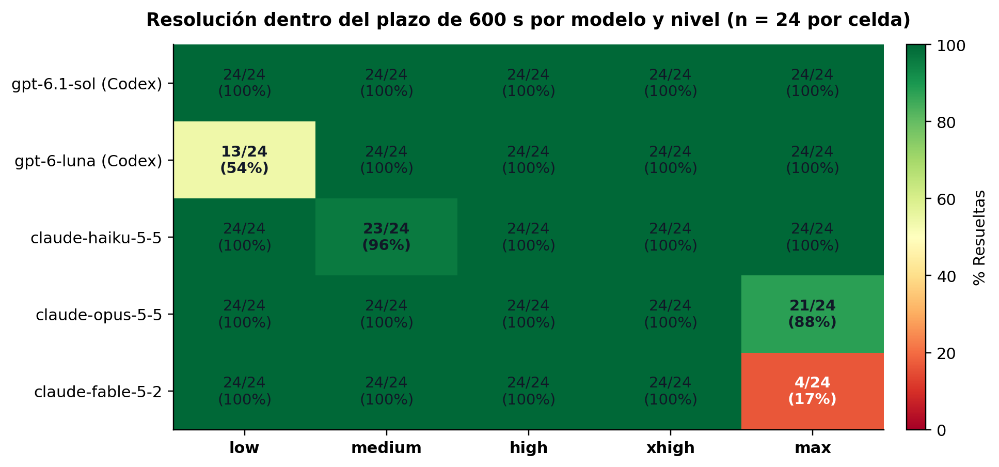
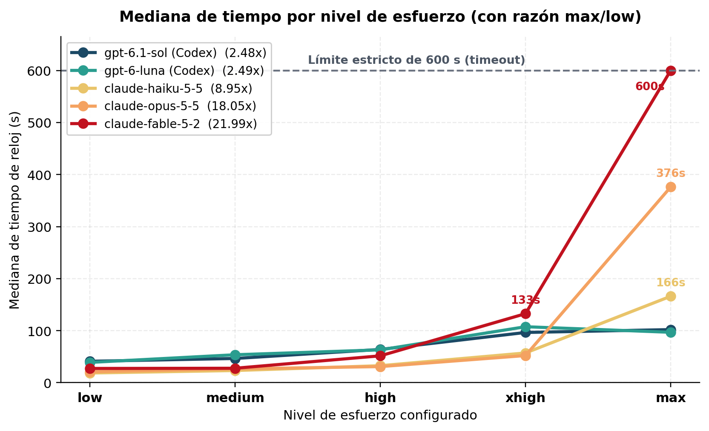
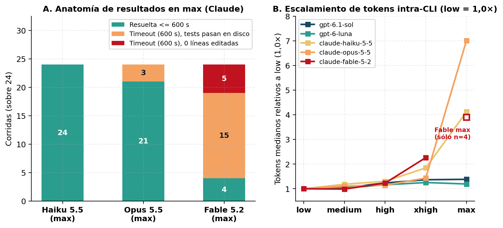

# ¿Más esfuerzo de razonamiento hace que un agente programe mejor? Estudio empírico pre-registrado de cinco modelos en 600 corridas agénticas

**Luis Arancibia · CrisoLabs**  
*Informe técnico · Experimento 03 · 15 de noviembre de 2026*  
*Artefactos y arnés de reproducción: `experimentos/03-esfuerzo-de-razonamiento/`*

---

## Resumen

En discusiones técnicas y guías de uso suele repetirse que configurar un agente de programación en esfuerzo `medium` resuelve alrededor del 90 % del trabajo diario y evita «tardar el triple» o sufrir *overthinking* en niveles `high` o `max`. Pusimos a prueba esa idea mediante un estudio empírico pre-registrado con **600 corridas principales evaluables** (`5` modelos × `5` niveles de esfuerzo × `8` tareas en Python × `3` repeticiones), además de `8` controles `high` entre tandas, `6` corridas diagnósticas y `3` corridas históricas del protocolo anterior fuera de matriz. Evaluamos `gpt-6.1-sol` y `gpt-6-luna` en Codex CLI (`0.166.0`), y `claude-haiku-5-5`, `claude-opus-5-5` y `claude-fable-5-2` en Claude Code (`2.1.317`), bajo un plazo estricto de `600` segundos y tests ocultos verificados por hash SHA-256.

**Los datos refutan cualquier regla universal.** Ni se cumple un factor fijo de «el triple de tiempo» ni subir el esfuerzo mejora de manera uniforme:
1. **`gpt-6.1-sol`** mostró efecto techo total (`24/24` en todos los niveles, `120/120`), multiplicando la mediana de tiempo por **2,48×** (`41,1 s` a `102,0 s`) y los tokens por **1,38×**.
2. **`gpt-6-luna`** sí necesitó salir de `low`: saltó de **`13/24` (54 %) en `low`** a **`24/24` (100 %) desde `medium` hasta `max`** (`+11` aciertos), sin ganar más aciertos por encima de `medium`. Un diagnóstico aparte de 6 corridas en `low` mostró fragilidad ante fallos de herramientas (`4/6` abandonaron con `0` líneas editadas tras recibir código `127` al leer archivos, mientras `2/6` sortearon el fallo usando `rg` o builtins de Bash).
3. **`claude-haiku-5-5`** resolvió `119/120` (`23/24` en `medium`, `24/24` en el resto), escalando el tiempo en **8,95×** (`18,6 s` a `166,1 s`) y los tokens en **4,12×**.
4. **`claude-opus-5-5`** resolvió `24/24` de `low` a `xhigh` (`20,8 s` a `52,1 s`), pero bajó a **`21/24` en `max`** por **3 timeouts de 600 s** (razón de tiempo **18,05×**; tokens **7,01×** parcial sobre `n = 21` recibos).
5. **`claude-fable-5-2`** (completado en dos tandas declaradas: `27` evaluables OAuth + `93` por API key tras agotarse la cuota de suscripción) logró **`24/24` de `low` a `xhigh`** y colapsó a **`4/24` (17 %) en `max`** porque **20 de 24 corridas agotaron el plazo de 600 s** (razón de tiempo **21,99×**). En **15 de esos 20 timeouts**, el código guardado en disco ya pasaba el 100 % de los tests ocultos; en los otros **5**, agotó los 600 segundos con `0` líneas modificadas.

Además, al auditar `archivos_extra` en las 600 filas, comprobamos `0` ediciones no autorizadas de archivos fuente en toda la matriz: todos los avisos de `fuera_alcance` en Haiku (`32`) y Opus (`40`) fueron archivos de bytecode `__pycache__/*.pyc` dejados al ejecutar Python durante la autoverificación.

---

## 1. Motivación y fuentes de la afirmación

Los CLI modernos exponen un selector explícito de esfuerzo (`low`, `medium`, `high`, `xhigh`, `max`). La documentación oficial de Anthropic describe `max` como capacidad máxima «sin restricciones sobre el gasto de tokens» y advierte que en tareas estructuradas o menos exigentes «puede provocar *overthinking*» (`anthropic2026effort`). En marzo de 2026, Boris Cherny (creador de Claude Code) explicó el cambio al valor predeterminado `medium` (`effort=85`) como un *sweet spot* entre inteligencia, latencia y costo para la mayoría de usuarios (`cherny2026hn`). OpenAI también recomienda reservar `xhigh` para flujos largos/asincrónicos únicamente cuando las evaluaciones muestren un beneficio neto (`openai2026reasoning`). En evaluaciones independientes sobre Opus 5.5 citando Artificial Analysis, Pascal Reischl reportó un consumo **4,5×** mayor en `max` frente a `medium` (`11×` frente a `low`) y resultados mixtos en pruebas de CodeRabbit (`reischl2026effort`), en línea con estudios previos de *overthinking* en matemática (`chen2024overthinking`).

Sin embargo, en redes circulan recetas categóricas sin control experimental detrás (como la idea de que el máximo «tarda el triple» y que `medium` resuelve más limpio el «90 % del código»). El **Experimento 03** mide qué pasa realmente bajo un banco congelado, reglas pre-registradas y sin editar resultados tras observar las respuestas.

---

## 2. Diseño experimental y pre-registro

### 2.1 Banco congelado de tareas

Antes de invocar ningún modelo congelamos 8 tareas en Python `3.12.3` (biblioteca estándar; `34` hashes SHA-256, commit `3bf43bd`):
- **5 tareas acotadas** (referencias de ~3–16 líneas cambiadas): `01-lotes` (partición de iterables), `02-intervalos` (fusión de intervalos cerrados), `03-importes` (parseo estricto de importes con coma), `04-espera` (backoff exponencial determinista) y `05-consulta` (actualización de query strings).
- **3 tareas de diseño** (referencias de ~68–85 líneas con reglas acopladas): `06-inventario` (libro de movimientos idempotente y transferencias atómicas), `07-planificador` (planificador DAG determinista por capacidad) y `08-cache` (caché LRU con TTL, reloj inyectado y carga perezosa).

Cada corrida parte de una copia limpia con `inicio/` y `TAREA.md`. Los tests ocultos (`ocultos/`) se copian recién al evaluar en una carpeta aparte (límite 30 s). Antes del piloto se verificó que todo `inicio/` falle y toda `referencia/` apruebe.

### 2.2 Pre-registro y enmiendas trazables

1. **Base (`README.md`, `e22569c`):** `gpt-6.1-sol` en `low`, `medium`, `high` (`72` corridas, semilla `20261113`).
2. **Extensión 01 (`EXTENSION-01.md`, `b267ab7`):** agrega `xhigh` y `max` en `gpt-6.1-sol` (`48` principales + `8` controles `high`, semilla `2026111301`).
3. **Extensión 02 (`EXTENSION-02.md`, `ENMIENDA-02-01.md`, `ENMIENDA-02-02.md`):** extiende los 5 niveles (semilla `2026111303`) a `gpt-6-luna` (Codex OAuth) y a Claude Code `2.1.317` (`claude-haiku-5-5`, `claude-opus-5-5`, `claude-fable-5-2`) con aislamiento `bwrap` y herramientas `{Read, Edit, Write, Glob, Grep, Bash}`. En `02-02`, `ENMIENDA-02-01` corrigió la clasificación de una reconexión de red de Luna y sumó 6 corridas diagnósticas aparte para `luna/low`; `claude-fable-5-2` se detuvo por cuota de suscripción tras `28` observadas (`27` evaluables, `1` corte por cuota sin evaluar y `92` nunca iniciadas).
4. **Enmienda 02-03 (`ENMIENDA-02-03.md`, `0a7ee11`):** completó las **93** celdas sin evaluación de Fable 5.2 inyectando `ANTHROPIC_API_KEY` en memoria dentro de `bwrap`, verificando por SHA-256 que `protocolo-02-02/` quedara intacto.

En toda la serie: concurrencia máxima **≤ 2 agentes simultáneos**, límite de pared **600 s** por agente y definición estricta de **resuelta** = proceso cerrado antes de 600 s + 100 % de tests ocultos aprobados en ≤ 30 s.

---

## 3. Resultados en las 600 corridas evaluables

### 3.1 Matriz general por modelo y nivel

| Modelo | Nivel | Resueltas / eval. | Mediana tiempo (s) | Razón tiempo `max/low` | Mediana tokens (`n`) | Razón tokens `max/low` |
|---|---|---:|---:|---:|---:|---:|
| `gpt-6.1-sol` | `low` → `max` | `24/24` en todos (**120/120**) | `41,1` → `46,5` → `63,9` → `96,5` → `102,0` | **2,48×** | `95.549` (`24`) → `132.110` (`24`) | **1,38×** |
| `gpt-6-luna` | `low` / `med`–`max` | **`13/24`** (`low`) / `24/24` (`med`–`max`) (**109/120**) | `38,9` → `53,6` → `63,1` → `107,5` → `96,8` | **2,49×** | `124.519` (`24`) → `148.684` (`24`) | **1,19×** |
| `claude-haiku-5-5` | `low`–`max` | `24/24` (`23/24` en `med`) (**119/120**) | `18,6` → `23,3` → `32,6` → `57,1` → `166,1` | **8,95×** | `47.353` (`24`) → `195.130` (`24`) | **4,12×** |
| `claude-opus-5-5` | `low`–`xhigh` / `max` | `24/24` (`low`–`xhigh`) / **`21/24`** (`max`) (**117/120**) | `20,8` → `26,5` → `30,9` → `52,1` → `376,2` | **18,05×** | `37.179` (`24`) → `260.660` (`21`) | **7,01×** *(parcial)* |
| `claude-fable-5-2` | `low`–`xhigh` / `max` | `24/24` (`low`–`xhigh`) / **`4/24`** (`max`) (**100/120**) | `27,3` → `27,7` → `51,6` → `132,6` → `600,2` | **21,99×** | `32.001` (`24`) → `124.818` (`4`) | **3,90×** *(parcial, n=4)* |

### 3.2 Latencia frente al mito de «tarda el triple»

La Figura 2 muestra que no hay un multiplicador único:
- Los dos modelos de Codex (`gpt-6.1-sol` y `gpt-6-luna`) rondaron **2,5×** entre `low` y `max` (`2,48×` y `2,49×`), e incluso `luna` fue levemente más rápido en `max` (`96,8 s`) que en `xhigh` (`107,5 s`).
- En Claude Code, el salto hacia `max` superó ampliamente el 3×: **8,95×** en Haiku, **18,05×** en Opus y **21,99×** en Fable 5.2 (topado por el corte de 600 s). Tomando `medium` como referencia frente a `max`, el tiempo mediano subió **7,12×** en Haiku, **14,21×** en Opus y **21,67×** en Fable.

### 3.3 Anatomía de los fallos: fragilidad en `low` vs. colapso por timeout en `max`

En las 600 corridas evaluables hubo **35 fallos funcionales** (`11` en Luna `low`, `1` en Haiku `medium`, `3` en Opus `max` y `20` en Fable `max`) y **0 fallos de infraestructura** dentro del denominador evaluable:

1. **Esfuerzo bajo y fricción de herramientas (`gpt-6-luna` en `low`):** falló `11/24` corridas en `low`. En las 6 corridas diagnósticas separadas, **4/6 terminaron con `0` líneas cambiadas** tras recibir retorno `127` en comandos de lectura de `TAREA.md`, pidiendo al usuario que le pegara el archivo; las **2/6 exitosas** también recibieron retorno `127` pero buscaron otra vía (`rg` o builtins de Bash). Subir a `medium` eliminó por completo esos fallos (`24/24`).
2. **Sobre-pensamiento y vencimiento del plazo en `max` (`Opus` y `Fable`):**
   - En **Opus `max`**, los `3` timeouts de 600 s ya habían escrito código que aprobaba el 100 % de los tests ocultos en disco (`105`, `185` y `195` líneas tocadas), pero no cerraron a tiempo.
   - En **Fable 5.2 `max`**, **20/24 corridas vencieron los 600 s** (consistente en ambos canales: `5/7` por OAuth en `02-02` y `15/17` por API key en `02-03`). La Figura 3A separa ambos tipos de timeout: **15** dejaron código funcional en disco que pasaba todos los tests ocultos sin haber cerrado el turno en 10 minutos, mientras que **5** consumieron los 600 segundos con **`0` líneas tocadas**.

### 3.4 Cambios fuera de alcance: diagnóstico de `__pycache__`

Al inspeccionar `archivos_extra` en los 600 registros crudos, verificamos **`0` modificaciones no autorizadas de archivos fuente** en toda la matriz. El 100 % de los flags de `fuera_alcance` en `claude-haiku-5-5` (`32` corridas) y `claude-opus-5-5` (`40` corridas) correspondió a archivos `__pycache__/<modulo>.cpython-312.pyc` generados al correr `python3` sin `-B` dentro del directorio temporal de trabajo.

---

## 4. Límites y amenazas a la validez

1. **Efecto techo y tamaño sintético:** son 8 tareas acotadas (`8`–`85` líneas de referencia) con `n = 3` repeticiones por celda; no miden repositorios grandes de producción ni calidad de diseño a largo plazo.
2. **Contabilidades distintas entre CLIs y mezcla de canal en Fable:** Codex y Claude reportan tokens de forma heterogénea, por lo que las comparaciones válidas de tokens son intra-CLI (Figura 3B normalizada a `low = 1,0×`). Fable combina `27` corridas OAuth y `93` por API key (`$14,1026` registrados en recibos JSON completados, sin incluir los 15 timeouts de `02-03` sin JSON final), aunque la tasa de timeout en `max` fue similar en ambos canales (`5/7` y `15/17`).
3. **Host compartido y ventanas temporales:** las tandas corrieron en días/horas distintas; el control `high` entre tandas de `gpt-6.1-sol` osciló entre `0,78×` y `1,33×` por tarea.

---

## 5. Conclusiones prácticas

1. **No existe una regla universal:** el nivel óptimo depende del modelo y del arnés. En este banco, `medium` resolvió `120/120` en cuatro modelos y `119/120` en Haiku, mientras `low` dejó expuesta una fragilidad operativa severa en `gpt-6-luna` (`13/24`).
2. **Cuidado con `max` sin presupuesto estricto de tiempo o turnos:** en Opus y especialmente en Fable 5.2, activar `max` disparó los tiempos (`18×`–`22×`) e hizo vencer el plazo de 10 minutos en `20/24` corridas, aun cuando `15` de ellas ya tenían la solución correcta escrita en disco.
3. **Las cifras no avalan promesas sobre «90 % del código más limpio»:** las suites funcionales miden corrección bajo tests ocultos, no mantenibilidad ni estilo.

---

## Referencias

- Anthropic (2026). *Effort — Claude Platform Docs*. https://platform.claude.com/docs/en/build-with-claude/effort
- Anthropic (2026). *Introducing Claude Fable 5.2 and Claude Mythos 5.2*. https://www.anthropic.com/claude-fable-and-mythos-5-2
- Chen, X., et al. (2024). *Do NOT Think That Much for 2+3=? On the Overthinking of o1-Like LLMs*. https://arxiv.org/abs/2412.21187
- Cherny, B. (2026). *Hacker News discussion on Claude Code default medium effort*. https://news.ycombinator.com/item?id=47664442
- OpenAI (2026). *Reasoning models — OpenAI API Documentation*. https://developers.openai.com/api/docs/guides/reasoning
- Reischl, P. (2026). *Claude effort levels: which one you actually need*. https://pascalreischl.com/en/blog/claude-effort-levels/
