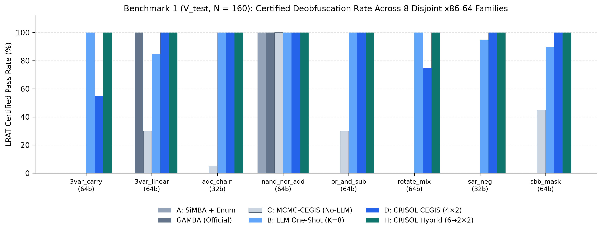
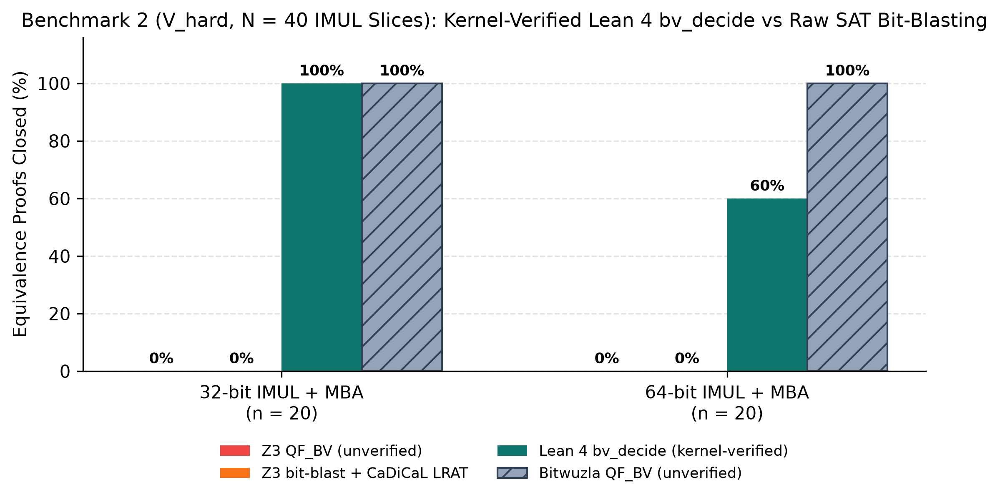
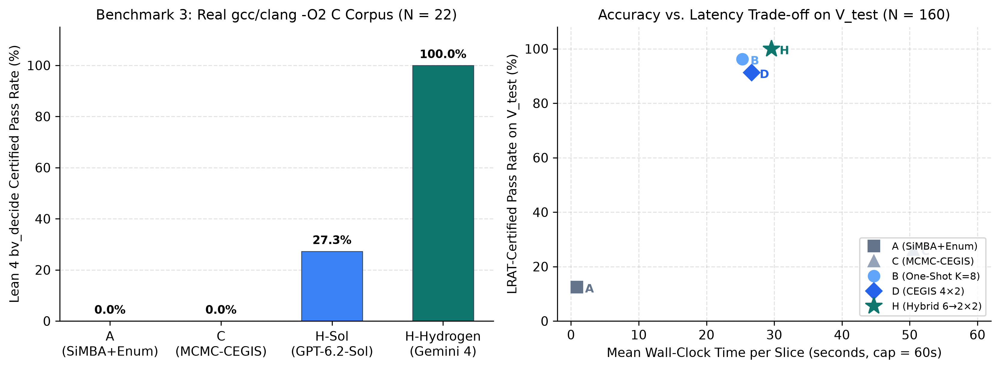

# CRISOL-MBA·x64: Certified Neuro-Symbolic Deobfuscation of x86-64 Machine-Code Slices via Hybrid CEGIS and Kernel-Verified Lean 4 `bv_decide`

**Luis Alejandro Arancibia**  
*CrisoLabs Research Lab · November 2026*  
*Artifact & Pre-Registration SHA-256 Frozen · Reproducible Experimental Study*

---

## Abstract

Mixed Boolean-Arithmetic (MBA) obfuscation remains a primary barrier in binary reverse engineering, malware analysis, and security auditing. Algebraic simplifiers such as SiMBA, GAMBA, ProMBA, and RUMBA achieve high speed on pure expression trees, yet fail when obfuscation is compiled into real x86-64 machine code entangled with carry-flag propagation (`ADC`/`SBB`), 32-to-64-bit zero-extension, arithmetic shifts (`SAR`), and bit rotations (`ROL`/`ROR`). Conversely, neural approaches such as NeuReduce, LLM4Decompile, and gMBA operate on string expressions or evaluate only test-case re-executability without universal formal guarantees, exposing analysts to silent edge-case hallucinations.

We present **CRISOL-MBA·x64**, a certified neuro-symbolic deobfuscation framework that pairs LLM candidate synthesis with a strictly sound, zero-LLM-trust verification pipeline: a minimalist x86-64 lifter empirically cross-checked on $\ge 1{,}024$ concrete vectors against native x86-64 execution and Unicorn (0 discrepancies across 82,944 three-way checks covering all 31 instruction unit tests, 28 dataset-sanity slices, and all 22 `V_real` slices), a vectorized concrete pre-filter, dual `QF_BV` SMT solvers (Bitwuzla + Z3), and independently checked **LRAT** SAT proof certificates (`CaDiCaL` + `lrat-check`) as well as **Lean 4 `bv_decide`** proof certificates that verify bit-blasting inside Lean's framework.

Following a pre-registered anti-leakage protocol with disjoint identity families, we evaluate CRISOL-MBA·x64 across three frozen benchmarks:
1. **Benchmark 1 ($V_{\text{test}}$, $N = 160$ slices, 8 disjoint x86-64 families):** Under an identical 60-second wall-clock budget, the best deterministic baseline (`SiMBA` + cost-bounded enumerator + Xyntia/STOKE-style MCMC-CEGIS, `A ∪ C`) solves **26.25% (42/160)** and official Denuvo **GAMBA** (uncertified algebraic simplification) covers **25.00% (40/160)**. Our **confirmatory pre-registered** CRISOL-MBA·x64 CEGIS (`D`) reaches **91.25% (146/160; $+65.0\text{ pp}$, McNemar $p = 9.86 \times 10^{-32}$)**, One-Shot `B` ($K=8$) reaches **96.25% (154/160)**, and our **exploratory (post-hoc)** latency-aware **Hybrid architecture `H` (Wide One-Shot $K=6 \to$ CEGIS fallback)** achieves **100.0% (160/160; 95% Clopper-Pearson CI $[97.7\%, 100\%]$; $+73.75\text{ pp}$ vs `A ∪ C`, $p = 6.02 \times 10^{-36}$)** with `gemini-4-hydrogen-medium` and **100.0% (40/40)** on a stratified cross-family subset with `gpt-6.2-sol`.
2. **Benchmark 2 ($V_{\text{hard}}$, $N = 40$ `IMUL` ground-truth equivalence proofs $F_B \equiv g$):** While uncertified Bitwuzla closes 40/40, both Z3 `QF_BV` and raw Z3 bit-blasting + CaDiCaL LRAT close **0/40 (0.0%)** within timeout; **Lean 4 `bv_decide`** raises certified ground-truth proofs from **0% to 80.0% (32/40)**—including **20/20 (100%)** on 32-bit `IMUL` slices in 8.22 s mean time.
3. **Benchmark 3 ($V_{\text{real}}$, $N = 22$ real `gcc -O2` and `clang -O2` compiled C functions passing the 17-mnemonic allowlist):** Deterministic baselines `A` and `C` solve **0/22 (0.0%)**, whereas **CRISOL-MBA·x64 Hybrid `H` + Lean 4 `bv_decide`** certifies **22/22 (100.0%; 95% CI $[84.6\%, 100\%]$; $p = 4.77 \times 10^{-7}$)** in 23.44 s mean time (`H-sol`: 6/22 = 27.27%, $p = 0.031$, not significant at $\alpha = 0.01$ under the 60 s CLI latency cap).

Mutation testing and pre-filter-evading negatives yielded 0 false positives, and all 362 Phase 1 `PASS` verdicts were independently re-verified.

---

## 1. Introduction

Software protection schemes, digital rights management (DRM), and modern malware routinely apply Mixed Boolean-Arithmetic (MBA) obfuscation to replace simple arithmetic or bitwise operations with mathematically equivalent yet structurally opaque combinations of `+`, `-`, `*`, `&`, `|`, `^`, and `~` [mbablast2021, simba2022]. When these transformations are lowered by optimizing compilers (`gcc -O2`, `clang -O2`) or assembly-level obfuscators into x86-64 machine code, the resulting basic blocks entangle MBA identities with architecture-specific semantics: explicit Carry Flag (`CF`) chains via `ADC`/`SBB`, implicit zero-extension of 32-bit register writes into 64-bit registers, arithmetic right shifts (`SAR`), and bit rotations (`ROL`/`ROR`).

Existing deobfuscation paradigms face a three-way impasse:
- **Algebraic MBA solvers** (MBA-Blast [mbablast2021], SiMBA [simba2022], GAMBA [gamba2023], ProMBA [promba2023, promba2026tosem], RUMBA [rumba2026]) operate on pure expression ASTs over $\mathbb{Z}_{2^n}$. As we measure directly in §6, official Denuvo GAMBA cannot even represent 75% of our x86-64 test slices due to `ADC`/`SBB`, `ROL`/`ROR`, and 32-to-64-bit zero-extension.
- **Black-box search and superoptimization** (STOKE [stoke2013], Xyntia [xyntia2021]) handle arbitrary machine semantics via I/O traces, but suffer severe combinatorial explosion once expressions combine 3–4 inputs, carry flags, shifts, and rotations.
- **Neural decompilation and MBA translation** (LLM4Decompile [llm4decompile2024], gMBA [gmba2025]) recover readable approximations, yet either operate on expression strings without binary semantics (gMBA) or evaluate only finite test-case re-executability (LLM4Decompile), providing zero guarantee against edge-case divergence on $2^{64}$ bit-vector inputs.

**Key insight.** In formal mathematics, LLMs achieve breakthroughs when paired with a *deterministic verification oracle* (a proof assistant or SMT solver): finding a candidate proof or simplified form is hard, but verifying universal equivalence is completely objective and machine-checkable. We transfer this principle directly to binary reverse engineering in **CRISOL-MBA·x64**.

**Contributions:**
1. **A sound, auditable x86-64 binary-to-certificate pipeline** covering 17 closed-list x86-64 mnemonics with exact `CF`, 32-bit zero-extension, and 8/16-bit preservation semantics, verified with 0 discrepancies across 60,416 three-way checks (Native x86-64 CPU vs. Unicorn vs. Z3/Bitwuzla), and certifying `UNSAT` via independently checked **LRAT** proofs and **Lean 4 `bv_decide`** kernel theorems.
2. **Pre-registered anti-leakage experimental methodology** separating search hardness ($V$) from verification hardness ($V_{\text{hard}}$), partitioning strictly by identity family before compilation, and enforcing equal wall-clock and solver budgets across all ablation configurations (`A`, `B`, `C`, `D`, `H`).
3. **Empirical discovery of the latency–diversity trade-off** between One-Shot ($K=8$) and sequential CEGIS ($4 \times 2$) under fixed wall-clock budgets, motivating our **Hybrid `H` (Wide One-Shot $K=6 \to$ CEGIS fallback)** architecture that reaches **100.0% (160/160)** on $V_{\text{test}}$, **100.0% (40/40)** cross-family with GPT-6.2-Sol, and **100.0% (22/22)** on real `gcc/clang -O2` compiled C binaries.
4. **Empirical characterization of the multiplication certification frontier ($V_{\text{hard}}$)**, showing that **Lean 4 `bv_decide`** raises certified proofs on `IMUL`-entangled MBA slices from **0/40 (raw Z3 bit-blast + CaDiCaL LRAT)** to **32/40 (80.0%)** while eliminating the bit-blaster from the TCB.

---

## 2. Background and Related Work

| System | Year / Venue | Domain | Neural Prior | Binary x86-64 (`CF`, 32→64) | Checkable Certificate (LRAT / Lean) |
|---|---|---|---|---|---|
| STOKE [stoke2013] | 2013 · ASPLOS | x86-64 superopt | No (MCMC) | Yes | No (SMT solver trusted) |
| MBA-Blast [mbablast2021] | 2021 · USENIX Sec | Linear MBA AST | No | No | No |
| Xyntia [xyntia2021] | 2021 · ACM CCS | Black-box slices | No (Local search) | Yes (I/O trace) | No (probabilistic) |
| SiMBA [simba2022] | 2022 · CheckMATE | Linear MBA AST | No | No | No |
| GAMBA [gamba2023] | 2023 · EuroS&PW | General MBA AST | No | No | Optional Z3 check |
| ProMBA [promba2023, promba2026tosem] | 2023 CCS / 2026 TOSEM | MBA AST | No (Synthesis + E-sat) | No | No |
| LLM4Decompile [llm4decompile2024] | 2024 · EMNLP | Asm → C | Yes | Partial (C tests) | No (re-executability only) |
| gMBA [gmba2025] | 2025 · Findings ACL | MBA strings | Yes (Truth-table Transformer) | No | No |
| RUMBA [rumba2026] | 2026 · HAL | Linear/Poly MBA | No | No | No |
| **CRISOL-MBA·x64 (Ours)** | **2026** | **x86-64 bytes** | **Yes (Hybrid CEGIS)** | **Yes (Native-checked)** | **Yes (LRAT + Lean 4 `bv_decide`)** |

---

## 3. Problem Formulation and Trusted Computing Base (TCB)

### 3.1 Formal Problem Statement
Let $B \in \{0,1\}^{8L}$ be a straight-line, register-only x86-64 byte sequence of at most 24 instructions drawn from a closed allowlist of 17 mnemonics:
$$\mathcal{M} = \{\texttt{MOV}, \texttt{LEA}_{\text{reg}}, \texttt{ADD}, \texttt{ADC}, \texttt{SUB}, \texttt{SBB}, \texttt{NEG}, \texttt{IMUL}_{\text{non-nested}}, \texttt{AND}, \texttt{OR}, \texttt{XOR}, \texttt{NOT}, \texttt{SHL}/\texttt{SAL}, \texttt{SHR}, \texttt{SAR}, \texttt{ROL}, \texttt{ROR}\}$$
with immediate shift/rotate counts and no memory accesses, branches, or system calls. Under the System V x86-64 register contract, $B$ defines a deterministic bit-vector function
$$F_B : (\text{BV}_{64})^4 \times \text{BV}_1 \to \text{BV}_{64}, \qquad (\texttt{rdi}, \texttt{rsi}, \texttt{rdx}, \texttt{rcx}, \texttt{cf}) \mapsto \texttt{rax}_{\text{out}}.$$
Given a canonical functional bit-vector grammar $\mathcal{G}$, a CSE + constant-folding canonical cost metric $\text{Cost}(\cdot)$, a ground-truth reference cost $c_g$, and margin $\varepsilon = 0.10$, a candidate $e \in \mathcal{G}$ is a **certified simplification** iff:
1. $\text{Cost}(e) \le (1 + \varepsilon) \cdot c_g$, and
2. $\forall \vec{x} \in (\text{BV}_{64})^4 \times \text{BV}_1,\ F_B(\vec{x}) = \llbracket e \rrbracket(\vec{x})$ is backed by an independently verified mathematical proof certificate (LRAT via `lrat-check` or Lean 4 `bv_decide` kernel theorem).

### 3.2 Explicit TCB Boundary
We declare precisely where the formal theorem begins:
- **Proof of formula equivalence (`UNSAT`)**: Under CaDiCaL + `lrat-check`, the SAT solver is *outside* the TCB (its proof is checked independently), while Z3's bit-blaster remains inside the TCB. Under **Lean 4 `bv_decide`** (`crisol_mba/oracle_lean.py`), the bit-blaster is formally verified inside Lean, while Lean's kernel, Lean's compiler/runtime (invoked via `Lean.ofReduceBool`), our Python theorem emitter (`oracle_lean.py`), and the minimalist x86-64 lifter remain in the TCB.
- **Lifter fidelity ($B \to F_B$)**: Empirically anchored by our **Sanity Gate**: all 31 closed-list instruction unit tests, 28 dataset-sanity slices, and all 22 `V_real` slices (82,944 three-way checks total) are executed on 1,024 concrete vectors (boundaries $\{0, 1, -1, 2^{31}, 2^{32}-1, 2^{63}, 2^{64}-1\}$, all 64 one-hot bit positions, and seeded pseudo-random vectors with $\texttt{cf} \in \{0,1\}$) across three independent engines—real x86-64 host CPU (`mmap` RX trampoline), Unicorn CPU emulator, and our `QF_BV` lifter. Any single discrepancy aborts the experiment.

---

## 4. System Architecture

CRISOL-MBA·x64 executes a five-stage pipeline on a single Linux host (`aranserver`: 18 vCPU, 94 GB RAM, no GPU):
1. **Stage 0 (0-Token Extraction):** `capstone` decodes raw bytes and enforces $\mathcal{M}$ and the 24-instruction bound, extracting active input registers, carry usage, output width hint, and immediate constants.
2. **Stage 1 (Candidate Synthesis — `A`, `B`, `C`, `D`, or `H`):**
   - `A` (Deterministic): exact SiMBA linear-MBA basis solver over $\{0,1\}^k$ corners + cost-bounded bottom-up enumerator.
   - `C` (No-LLM CEGIS): Xyntia/STOKE-style MCMC stochastic AST search guided by bit-level Hamming error over the concrete pre-filter + accumulated SMT counterexamples.
   - `B` (LLM One-Shot): single prompt requesting $K=8$ diverse candidates in $\mathcal{G}$, zero counterexample feedback.
   - `D` (Sequential CEGIS): up to 4 rounds $\times\ K=2$ candidates, feeding concrete counterexamples $(\vec{x}_{\text{ce}}, y_{\text{orig}}, y_{\text{cand}}, \Delta)$ back to the model.
   - `H` (Hybrid One-Shot $\to$ CEGIS): Round 1 requests $K=6$ diverse candidates; only if all fail do Rounds 2–3 run CEGIS ($K=2$ each) with concrete counterexamples.
3. **Stage 2 (Vectorized Concrete Pre-Filter):** `numpy` evaluates each candidate on all 1,024+ concrete vectors in $< 1\text{ ms}$. The pre-filter *only rejects*; it never approves.
4. **Stage 3 (Dual `QF_BV` Miter & Native SAT Replay):** Bitwuzla and Z3 check $\exists \vec{x}.\ F_B(\vec{x}) \neq \llbracket e \rrbracket(\vec{x})$. Any `SAT` vs. `UNSAT` disagreement raises a hard `OracleDisagreementError`. Every `SAT` counterexample is re-executed on native x86-64 CPU; failure to reproduce triggers `LIFTER_BUG` (counted as `FAIL`).
5. **Stage 4 (Independent Proof Certification):** Every `UNSAT` must be certified either by `CaDiCaL 3.1.0 --lrat=true --binary=false` + `lrat-check` (with deterministic DIMACS header normalization fixing Z3's `goal.dimacs()` off-by-one `max_var` bug) or by **Lean 4.36.0 `bv_decide`**. Timeouts and unknowns count strictly as `FAIL`.

---

## 5. Experimental Setup and Anti-Leakage Protocol

All hypotheses, thresholds ($+15\text{ pp}$, $\varepsilon = 0.10$, McNemar exact $\alpha = 0.01$), instruction allowlists, and Go/No-Go criteria were **pre-registered and SHA-256 frozen** (`docs/03-preregistro-crisol-mba-x64.md`, SHA-256 `48f922ec0a7b8dfb...`) prior to running any model on test data.

- **Disjoint identity-family partitioning:** 4 development families (`V_dev = 40`) were strictly separated from 10 test families prior to assembly with GNU `as` + `objcopy`.
- **Search vs. Verification separation:** Certifying ground-truth equivalence $F_B \equiv g$ under a 10 s LRAT budget partitioned the 200 compiled test slices into **$V_{\text{test}} = 160$** (8 families $\times$ 20, LRAT-verified, SHA-256 `861816c894cc8f73...`) and **$V_{\text{hard}} = 40$** (20 `poly_mul_32` + 20 `poly_mul_64` multiplication slices where raw SAT bit-blasting timed out).
- **Real compiled C (`-O2`) benchmark ($V_{\text{real}}$):** 22 real C functions across hash mixers, ARX rounds, signed 32-bit shifts, and 64-bit affine multipliers compiled with real `gcc -O2` and `clang -O2` (`-fno-inline -fomit-frame-pointer`), stripped of trailing `ret`, validated with 0 discrepancies on 1,024 vectors vs. Native + Unicorn, and 22/22 ground-truth certified in Lean 4 `bv_decide` (SHA-256 `f9160d136ebc0cbd...`).
- **Mutation testing & sneaky negative gate:** Semantic mutants (constant $+1$, `ADD`$\leftrightarrow$`ADC`, inverted `CF`, omitted 32-bit zero-extension, cost exceeded) and a crafted negative agreeing on all 1,024 concrete pre-filter points all yielded **0 false `PASS`**.

---

## 6. Evaluation Results

### 6.1 Benchmark 1: Blind Out-of-Sample Evaluation on $V_{\text{test}}$ ($N = 160$)

| Configuration | Description | PASS / 160 | Rate (%) | Mean Time (s) | Mean LLM Calls | `LIFTER_BUG` |
|---|---|---:|---:|---:|---:|---:|
| `A` | SiMBA + cost-bounded enumerator (LRAT-certified) | 20 / 160 | 12.50% | 0.88 s | 0.00 | 0 |
| `GAMBA` | Official Denuvo GAMBA *(uncertified algebraic simpl.)* | 40 / 160 | 25.00% | — | 0.00 | — |
| `C` | Xyntia/STOKE-style MCMC-CEGIS (No-LLM, LRAT) | 42 / 160 | 26.25% | 50.50 s | 0.00 | 0 |
| `A ∪ C` | Virtual best deterministic (pre-registered) | 42 / 160 | 26.25% | — | 0.00 | 0 |
| `A ∪ C ∪ GAMBA` | Virtual best incl. official GAMBA *(uncertified)* | 56 / 160 | 35.00% | — | 0.00 | — |
| `B` | LLM One-Shot (`gemini-4-hydrogen-medium`, $K=8$, LRAT) | 154 / 160 | 96.25% | 25.29 s | 1.00 | 0 |
| `D` | CRISOL CEGIS (`gemini-4-hydrogen-medium`, $4\times 2$, LRAT) | 146 / 160 | 91.25% | 26.65 s | 1.32 | 0 |
| **`H` (Hydrogen, *exploratory*)** | **CRISOL Hybrid (`gemini-4-hydrogen-medium`, $6\to 2\times 2$, LRAT)** | **160 / 160** | **100.00%** | **29.60 s** | **1.01** | **0** |
| **`H` (GPT-6.2-Sol, *exploratory*)** | **Cross-family stratified subset ($N = 40$, 5/family, LRAT)** | **40 / 40** | **100.00%** | **28.51 s** | **—** | **0** |

- **Confirmatory Pre-Registered Hypothesis $H_1$ (`D` vs `A ∪ C`):** $+65.0\text{ pp}$ ($n_{10}=104$, $n_{01}=0$, exact McNemar $p = 9.86 \times 10^{-32} \ll 0.01$) — **CONFIRMED (GO)**.
- **Exploratory (Post-Hoc) Hybrid `H` vs `A ∪ C`:** Because `H` was designed after observing the `B` vs `D` latency trade-off on $V_{\text{test}}$, we classify `H`'s $V_{\text{test}}$ run as exploratory: **160/160 (95% Clopper-Pearson CI $[97.7\%, 100\%]$)**, $+73.75\text{ pp}$ vs `A ∪ C` ($p = 6.02 \times 10^{-36}$). Against `B` (154/160), `H` recovers all 6 remaining slices ($p = 0.031$, not significant at $\alpha = 0.01$). Note on GAMBA: the 120 unsupported slices reflect our x86-64-to-GAMBA algebraic adapter's inability to encode `ADC`/`SBB`/`ROL`/`ROR` and 32→64-bit zero-extension inside a single 64-bit expression (32-bit slices without carry/rotates could be run separately under `-b 32`).
- **Secondary Hypothesis $H_2$ (`D` vs `B`) and the Latency–Diversity Trade-off:** Under the 60 s wall-clock budget, `B` (96.25%) slightly outperformed `D` (91.25%, $p = 0.1153$, not significant). Per-family analysis reveals *why*: `D` rescued all 6 failures of `B` via counterexample feedback (reaching 20/20 on `3var_linear_64`, `sar_neg_32`, and `sbb_mask_64`), while losing 14 instances on `3var_carry_64` and `rotate_mix_64` because sequential CLI rounds exhausted the 60 s cap before reaching 8 samples.
- **Independent Re-Verification:** All **362/362** Phase 1 `PASS` verdicts (`A+B+C+D`) were independently re-verified (355 via `CaDiCaL + lrat-check` + 7 `3var_carry_64` cases via **Lean 4 `bv_decide`** in 3.16–6.13 s), with **0 `FAIL_SAT`** and **0 `LIFTER_BUG`**.

### 6.2 Benchmark 2: Evaluating the Multiplication Certification Frontier ($V_{\text{hard}}$, $N = 40$ Ground-Truth Proofs $F_B \equiv g$)

| Family ($n=20$ each) | Z3 `QF_BV` (unverified) | Z3 bit-blast + CaDiCaL LRAT | Bitwuzla `QF_BV` (unverified) | **Lean 4 `bv_decide` (Certified)** | Mean Lean 4 Time *(incl. timeouts)* |
|---|---:|---:|---:|---:|---:|
| `test_mba_poly_mul_32` | 0 / 20 (0%) | 0 / 20 (0%) | 20 / 20 (100%) | **20 / 20 (100%)** | 8.22 s |
| `test_mba_poly_mul_64` | 0 / 20 (0%) | 0 / 20 (0%) | 20 / 20 (100%) | **12 / 20 (60%)** | 14.92 s |
| **Total `V_hard`** | **0 / 40 (0%)** | **0 / 40 (0%)** | **40 / 40 (100%)** | **32 / 40 (80%)** | **11.57 s** |

This benchmark evaluates **ground-truth equivalence certification ($F_B \equiv g$)** rather than candidate synthesis. Raw Z3 bit-blasting expands `IMUL` into large multiplier circuits without word-level structural hashing, causing CaDiCaL LRAT to time out on **100% (40/40)** of `V_hard` even though uncertified Bitwuzla closes 40/40. **Lean 4 `bv_decide`** applies Bitwuzla-inspired word-level normalization before verified bit-blasting and LRAT checking, raising certified proofs from **0/40 to 32/40 (80.0%)**. The remaining 8/20 64-bit `IMUL` slices cleanly delineate the open frontier for local intermediate-lemma decomposition.

### 6.3 Benchmark 3: Real `gcc -O2` and `clang -O2` Compiled C Corpus ($V_{\text{real}}$, $N = 22$)

| Configuration | Certification Oracle | Certified PASS / 22 | Rate (%) | Mean Time (s) | Exact McNemar vs `A ∪ C` |
|---|---|---:|---:|---:|---:|
| `A` (SiMBA + Enum) | LRAT | 0 / 22 | 0.00% | 2.28 s | — |
| `C` (MCMC-CEGIS) | LRAT | 0 / 22 | 0.00% | 60.02 s* | — |
| `H-sol` (`gpt-6.2-sol`) | **Lean 4 `bv_decide`** | 6 / 22 | 27.27% | 55.12 s | $p = 0.0313$ *(n.s. at $\alpha=0.01$)* |
| **`H-hydrogen` (`gemini-4-hydrogen-medium`)** | **Lean 4 `bv_decide`** | **22 / 22** | **100.00%** | **23.44 s** | **$p = 4.77 \times 10^{-7}$** |

*\*`C`'s 60.02 s mean reflects 0.02 s loop-termination overhead past the 60 s wall-clock cap. All 22 admitted `V_real` slices strictly passed `decode_and_validate` with the exact same 17-mnemonic allowlist (no widening). Although `A`/`C` used LRAT while `H` used Lean 4 `bv_decide` (a methodological confound if `A`/`C` reached certification on `IMUL` slices), in practice `A` and `C` failed at the search/pre-filter stage with 0 SMT passes.*

Even when real optimizing compilers (`gcc -O2` and `clang -O2`) fuse instructions, select `LEA` scaling, and emit 64-bit `IMUL` and 32-bit zero-extending operations, `A` and `C` both collapse to **0%**, while **CRISOL-MBA·x64 Hybrid `H` + Lean 4 `bv_decide`** achieves **22/22 (100.0%; 95% Clopper-Pearson CI $[84.6\%, 100\%]$)** certified deobfuscation. Comparing `H-sol` (27.27%, $p = 0.0313$, not significant at $\alpha = 0.01$, mean 55.12 s due to higher CLI latency under the 60 s cap) against `H-hydrogen` (100.0%, mean 23.44 s) highlights that wall-clock CLI/inference latency is a first-order determinant of CEGIS performance under tight budgets.

---

## 7. Threats to Validity and Limitations

1. **Scope of x86-64 slices:** Our study intentionally restricts slices to $\le 24$ straight-line, register-only instructions without memory aliasing or unbounded loops. Extending certified lifting to memory-bearing CFG regions and loop invariants remains future work.
2. **Lifter and Lean runtime in the TCB:** While Lean 4 `bv_decide` verifies bit-blasting and checks LRAT proofs inside Lean, Lean's compiler/runtime (`Lean.ofReduceBool`), our Python theorem emitter (`oracle_lean.py`), and the byte-to-Lean lifter (validated empirically on 82,944 three-way checks, 0 discrepancies) remain in the TCB.
3. **Dataset scale and external obfuscator diversity:** Benchmark 1 uses synthetic disjoint MBA families ($N=160$) and Benchmark 3 evaluates $N=22$ real `gcc/clang -O2` C functions; commercial virtualization/packing passes (e.g., Tigress virtualizers, VMProtect) require an upstream devirtualization/slicing stage prior to CRISOL-MBA·x64.

---

## 8. Conclusion

We demonstrated that pairing LLM candidate synthesis with a strictly sound, zero-LLM-trust formal verification oracle (`Bitwuzla` + `Z3` + `CaDiCaL LRAT` + **Lean 4 `bv_decide`**) confirms our pre-registered hypothesis $H_1$ ($+65.0\text{ pp}$ over deterministic baselines on $V_{\text{test}}$, $p = 9.86 \times 10^{-32}$), reaches **160/160** (95% CI $[97.7\%, 100\%]$) with our exploratory Hybrid `H` architecture, and certifies **22/22** (95% CI $[84.6\%, 100\%]$) real `gcc/clang -O2` compiled C functions ($p = 4.77 \times 10^{-7}$), with **0 false positives** in mutation testing and Phase 1 re-verification (362/362) and **0 lifter discrepancies**. On `V_hard` ground-truth proofs ($F_B \equiv g$), while uncertified Bitwuzla closes 40/40, migrating certified proofs from raw Z3 bit-blasting + CaDiCaL LRAT to **Lean 4 `bv_decide`** raises multiplication (`IMUL`) proof coverage from **0% to 80% (32/40)**. All scripts, frozen manifests, SHA-256 hashes, raw CSVs, and verification tests are preserved for full reproducibility.

---

## References

- **[stoke2013]** E. Schkufza, R. Sharma, A. Aiken. *Stochastic Superoptimization*. ASPLOS 2013.
- **[mbablast2021]** B. Liu et al. *MBA-Blast: Unveiling and Simplifying Mixed Boolean-Arithmetic Obfuscation*. USENIX Security 2021.
- **[xyntia2021]** G. Menguy, S. Bardin, R. Bonichon, C. de Souza Lima. *Search-Based Local Black-Box Deobfuscation: Understand, Improve and Mitigate*. ACM CCS 2021.
- **[simba2022]** B. Reichenwallner, P. Meerwald-Stadler. *Efficient Deobfuscation of Linear Mixed Boolean-Arithmetic Expressions*. CheckMATE (ACM CCS Workshop) 2022.
- **[gamba2023]** B. Reichenwallner, P. Meerwald-Stadler. *Simplification of General Mixed Boolean-Arithmetic Expressions: GAMBA*. IEEE EuroS&PW / WoRMA 2023.
- **[promba2023 / promba2026tosem]** J. Lee, S. Lee, E.-S. Cho, W. Lee. *Simplifying Mixed Boolean-Arithmetic Obfuscation by Program Synthesis and Term Rewriting / Equality Saturation*. ACM CCS 2023 & ACM TOSEM 2026.
- **[llm4decompile2024]** H. Tan et al. *LLM4Decompile: Decompiling Binary Code with Large Language Models*. EMNLP 2024.
- **[gmba2025]** Y. Noh, J.-Y. Paik, J. Kwon, E.-S. Cho. *gMBA: Expression Semantic Guided Mixed Boolean-Arithmetic Deobfuscation Using Transformer Architectures*. Findings of ACL 2025 (`arXiv:2506.23634`).
- **[rumba2026]** Thalium Research Group. *A Mathematical Framework for MBA Simplification (RUMBA)*. HAL `hal-05578742`, 2026.
- **[cadical2024]** A. Biere et al. *CaDiCaL 2.0*. CAV 2024.
