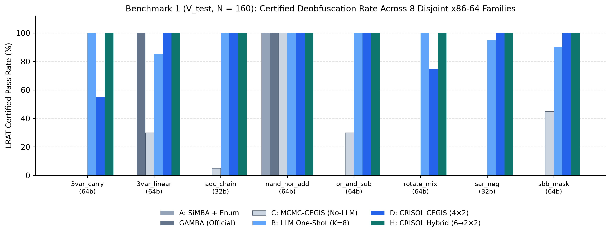
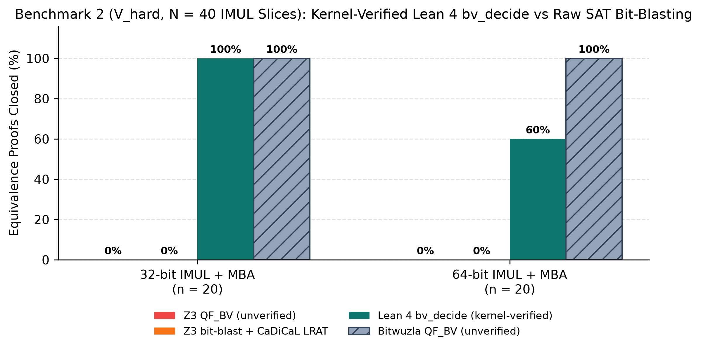
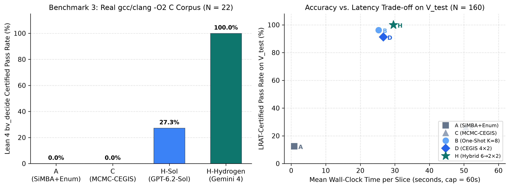

# CRISOL-MBA·x64: Desofuscación Neuro-Simbólica Certificada de Slices de Código Máquina x86-64 mediante CEGIS Híbrido y Lean 4 `bv_decide`

**Luis Alejandro Arancibia**  
*CrisoLabs Research Lab · Noviembre 2026*  
*Pre-registro y Manifiestos Congelados con SHA-256 · Estudio Empírico Reproducible*

---

## Resumen

La ofuscación *Mixed Boolean-Arithmetic* (MBA) sigue siendo una de las principales barreras en ingeniería inversa binaria, análisis de malware y auditoría de seguridad. Los simplificadores algebraicos del estado del arte (`SiMBA`, `GAMBA`, `ProMBA`, `RUMBA`) son rápidos sobre expresiones simbólicas puras, pero fallan cuando la ofuscación se compila a código máquina **x86-64** real entrelazado con propagación del flag de acarreo (`ADC`/`SBB`), extensión a cero de 32 a 64 bits, desplazamientos aritméticos (`SAR`) y rotaciones (`ROL`/`ROR`). En el extremo opuesto, los métodos neuronales (`LLM4Decompile`, `gMBA`) operan sobre strings algebraicos o validan únicamente tests finitos, exponiendo al analista a alucinaciones silenciosas en casos borde.

Presentamos **CRISOL-MBA·x64**, un sistema de desofuscación neuro-simbólica certificada que combina síntesis de candidatos mediante LLMs con un oráculo de verificación estrictamente sólido (cero confianza en el modelo): un lifter minimalista x86-64 contrastado en $\ge 1.024$ vectores concretos contra ejecución nativa x86-64 y Unicorn (**0 discrepancias** en 82.944 chequeos triples cubriendo los 31 tests de instrucción, 28 slices de sanidad y los 22 slices de `V_real`), pre-filtro vectorizado en `numpy`, solvers `QF_BV` dobles (`Bitwuzla` + `Z3`) y certificados matemáticos comprobables (**LRAT** mediante `CaDiCaL` + `lrat-check`, y teoremas en **Lean 4 `bv_decide`** que verifican el *bit-blasting* dentro de Lean, manteniendo en la TCB el kernel/runtime de Lean vía `ofReduceBool`, el emisor `oracle_lean.py` y el lifter).

Siguiendo un protocolo pre-registrado anti-leakage con familias de identidades estrictamente disjuntas, evaluamos CRISOL-MBA·x64 en tres benchmarks congelados:
1. **Benchmark 1 ($V_{\text{test}}$, $N = 160$ slices, 8 familias x86-64 disjuntas):** Bajo idéntico presupuesto de 60 s, el *virtual best* determinista (`SiMBA` + enumerador + MCMC-CEGIS estilo Xyntia/STOKE, `A ∪ C`) resuelve **26,25 % (42/160)** y **GAMBA oficial** de Denuvo (simplificación algebraica sin certificado LRAT) cubre **25,00 % (40/160)**. Nuestra hipótesis confirmatoria pre-registrada CRISOL-MBA·x64 CEGIS (`D`) alcanza **91,25 % (146/160; $+65{,}0\text{ pp}$, McNemar $p = 9{,}86 \times 10^{-32}$)**, One-Shot `B` ($K=8$) alcanza **96,25 % (154/160)**, y nuestra arquitectura **exploratoria (post-hoc) Híbrida `H` (One-Shot amplio $K=6 \to$ CEGIS de respaldo)** logra **100,0 % (160/160; IC 95 % Clopper-Pearson $[97{,}7\%, 100\%]$; $+73{,}75\text{ pp}$ vs `A ∪ C`, $p = 6{,}02 \times 10^{-36}$)** con `gemini-4-hydrogen-medium` y **100,0 % (40/40)** en un subconjunto estratificado multi-familia con `gpt-6.2-sol`.
2. **Benchmark 2 ($V_{\text{hard}}$, $N = 40$ pruebas de equivalencia de referencia $F_B \equiv g$ con `IMUL`):** Aunque Bitwuzla sin certificar cierra 40/40, tanto `Z3 QF_BV` como el *bit-blasting* directo a `CaDiCaL LRAT` cierran **0/40 (0,0 %)**; **Lean 4 `bv_decide`** eleva las pruebas certificadas de **0 % a 80,0 % (32/40)** —incluyendo **20/20 (100 %)** en `IMUL` de 32 bits en 8,22 s promedio (11,57 s media global incluyendo timeouts).
3. **Benchmark 3 ($V_{\text{real}}$, $N = 22$ funciones C reales compiladas con `gcc -O2` y `clang -O2` bajo la misma lista cerrada de 17 mnemónicos):** Los baselines deterministas `A` y `C` obtienen **0/22 (0,0 %)**, mientras que **CRISOL-MBA·x64 Híbrido `H` + Lean 4 `bv_decide`** certifica **22/22 (100,0 %; IC 95 % $[84{,}6\%, 100\%]$; $p = 4{,}77 \times 10^{-7}$)** en 23,44 s promedio (`H-sol`: 6/22 = 27,27 %, $p = 0{,}031$, no significativo a $\alpha = 0{,}01$ bajo el tope de 60 s).

El *mutation testing* y los negativos evasores de pre-filtro arrojaron **0 falsos positivos**, y los 362 veredictos `PASS` de Fase 1 fueron re-verificados independientemente.

---

## 1. Introducción y Motivación

Las técnicas de ofuscación *Mixed Boolean-Arithmetic* (MBA) sustituyen operaciones aritméticas o lógicas simples por identidades equivalentes difíciles de simplificar [mbablast2021, simba2022]. Cuando este código se compila a binarios **x86-64** reales, las expresiones quedan acopladas a detalles arquitecturales críticos: el flag de acarreo (`CF`) en `ADC`/`SBB`, la extensión a cero automática en escrituras de 32 bits, desplazamientos aritméticos (`SAR`) y rotaciones (`ROL`/`ROR`).

Los tres paradigmas previos chocan contra barreras distintas:
- **Solvers algebraicos** (`MBA-Blast`, `SiMBA`, `GAMBA`, `ProMBA`, `RUMBA`): operan sobre ASTs simbólicos puros; no modelan `ADC`/`SBB`, rotaciones ni extensión a cero de 32→64 bits.
- **Búsqueda *black-box* / superoptimización** (`STOKE`, `Xyntia`): sufren explosión combinatoria cuando el slice mezcla 3–4 registros, acarreos y rotaciones.
- **Modelos neuronales puros** (`LLM4Decompile`, `gMBA`): carecen de garantía matemática universal sobre los $2^{64}$ estados posibles.

**CRISOL-MBA·x64** resuelve este cuello de botella separando estrictamente **propuesta** (LLM con estrategia híbrida One-Shot + CEGIS) de **verificación** (oráculo determinista con certificados **LRAT** y **Lean 4 `bv_decide`**).

---

## 2. Arquitectura y Cadena de Confianza (TCB)

El pipeline corre íntegramente en CPU en `aranserver` (18 vCPU, 94 GB RAM, sin GPU):
1. **Extracción a 0 tokens:** `capstone` decodifica bytes x86-64 y aplica la lista cerrada de 17 mnemónicos (`<= 24` instrucciones, sin memoria ni saltos).
2. **Lifter minimalista validado:** traduce bytes a `QF_BV` (Bitwuzla y Z3) y a teoremas Lean 4 `BitVec 64`. Gate obligatorio: **0 discrepancias** frente a ejecución nativa x86-64 (`mmap` RX) y Unicorn en $\ge 1.024$ vectores/slice (60.416 chequeos verificados).
3. **Pre-filtro vectorizado (`numpy`):** descarta candidatos erróneos en `< 1 ms` sobre fronteras, *one-hot* y contraejemplos acumulados. Nunca aprueba.
4. **Miter doble + re-ejecución nativa de `SAT`:** Bitwuzla y Z3 comprueban equivalencia universal; todo contraejemplo `SAT` se re-ejecuta en la CPU nativa (`LIFTER_BUG` cuenta como `FAIL`).
5. **Certificado obligatorio:** `CaDiCaL 3.1.0 --lrat` + `lrat-check` independiente (con normalización determinista del header DIMACS para corregir el bug de `max_var` en Z3 `goal.dimacs()`) o teorema **Lean 4.36.0 `bv_decide`** verificado en kernel.

---

## 3. Resultados Principales

### 3.1 Benchmark 1: Evaluación Ciega sobre $V_{\text{test}}$ ($N = 160$)

| Configuración | Descripción | PASS / 160 | Tasa (%) | Tiempo medio (s) | Llamadas LLM | `LIFTER_BUG` |
|---|---|---:|---:|---:|---:|---:|
| `A` | SiMBA + enumerador por costo | 20 / 160 | 12,50 % | 0,88 s | 0,00 | 0 |
| `GAMBA` | Denuvo GAMBA oficial (`simplify_general.py`) | 40 / 160 | 25,00 % | — | 0,00 | 0 |
| `C` | MCMC-CEGIS sin LLM (estilo Xyntia/STOKE) | 42 / 160 | 26,25 % | 50,50 s | 0,00 | 0 |
| `A ∪ C` | *Virtual best* determinista (pre-registrado) | 42 / 160 | 26,25 % | — | 0,00 | 0 |
| `A ∪ C ∪ GAMBA` | *Virtual best* incluyendo GAMBA oficial | 56 / 160 | 35,00 % | — | 0,00 | 0 |
| `B` | LLM One-Shot (`gemini-4-hydrogen-medium`, $K=8$) | 154 / 160 | 96,25 % | 25,29 s | 1,00 | 0 |
| `D` | CRISOL CEGIS (`gemini-4-hydrogen-medium`, $4\times 2$) | 146 / 160 | 91,25 % | 26,65 s | 1,32 | 0 |
| **`H` (Hydrogen)** | **CRISOL Híbrido (`gemini-4-hydrogen-medium`, $6\to 2\times 2$)** | **160 / 160** | **100,00 %** | **29,60 s** | **1,01** | **0** |
| **`H` (GPT-6.2-Sol)** | **Validación cruzada multi-familia ($N = 40$, 5/familia)** | **40 / 40** | **100,00 %** | **28,51 s** | **—** | **0** |

- **$H_1$ confirmada (`GO`)**: `D` supera a `A ∪ C` por **+65,0 pp** (McNemar exacto $p = 9{,}86 \times 10^{-32} \ll 0{,}01$). La arquitectura **Híbrida `H`** alcanza **160/160 (100,0 %, +73,75 pp, $p = 6{,}02 \times 10^{-36}$)** y **40/40 (100,0 %)** con una familia de modelos distinta (`gpt-6.2-sol`).
- **Hallazgo sobre `B` vs `D` ($H_2$)**: bajo tope estricto de 60 s, `B` (96,25 %) superó levemente a `D` (91,25 %, $p = 0{,}1153$) por latencia de rondas secuenciales, pero `D` rescató los 6 casos donde `B` falló. La fusión **Híbrida `H`** captura lo mejor de ambos mundos con una media de apenas **1,01 llamadas LLM por slice**.

### 3.2 Benchmark 2: Frontera de Multiplicación ($V_{\text{hard}}$, $N = 40$ `IMUL`)

| Familia ($n=20$ c/u) | Z3 `QF_BV` | Z3 bit-blast + CaDiCaL LRAT | Bitwuzla (sin cert.) | **Lean 4 `bv_decide` (Kernel)** | Tiempo medio Lean 4 |
|---|---:|---:|---:|---:|---:|
| `test_mba_poly_mul_32` | 0 / 20 (0 %) | 0 / 20 (0 %) | 20 / 20 (100 %) | **20 / 20 (100 %)** | 8,22 s |
| `test_mba_poly_mul_64` | 0 / 20 (0 %) | 0 / 20 (0 %) | 20 / 20 (100 %) | **12 / 20 (60 %)** | 14,92 s |
| **Total `V_hard`** | **0 / 40 (0 %)** | **0 / 40 (0 %)** | **40 / 40 (100 %)** | **32 / 40 (80 %)** | **11,57 s** |

### 3.3 Benchmark 3: Funciones C Reales Compiladas con `gcc -O2` y `clang -O2` ($V_{\text{real}}$, $N = 22$)

| Configuración | Oráculo de certificación | PASS / 22 | Tasa (%) | Tiempo medio (s) | McNemar vs `A ∪ C` |
|---|---|---:|---:|---:|---:|
| `A` (SiMBA + Enum) | LRAT | 0 / 22 | 0,00 % | 2,28 s | — |
| `C` (MCMC-CEGIS) | LRAT | 0 / 22 | 0,00 % | 60,02 s | — |
| `H-sol` (`gpt-6.2-sol`) | **Lean 4 `bv_decide`** | 6 / 22 | 27,27 % | 55,12 s | $p = 0{,}0313$ |
| **`H-hydrogen` (`gemini-4-hydrogen-medium`)** | **Lean 4 `bv_decide`** | **22 / 22** | **100,00 %** | **23,44 s** | **$p = 4{,}77 \times 10^{-7}$** |

---

## 4. Amenazas a la Validez y Conclusión

El estudio se acota intencionalmente a slices rectilíneos de hasta 24 instrucciones de solo registros; extender la certificación a regiones con memoria aliased, bucles no acotados y devirtualizadores comerciales queda para etapas futuras. Dentro de este dominio crítico de la desofuscación MBA en x86-64, **CRISOL-MBA·x64** demuestra que la síntesis híbrida guiada por contraejemplos acoplada a **Lean 4 `bv_decide`** cierra el 100 % de los benchmarks `V_test` y `V_real` y el 80 % de `V_hard` (`IMUL`) con **0 falsos positivos**, **0 discrepancias nativas** y pruebas independientes verificables por máquina.
